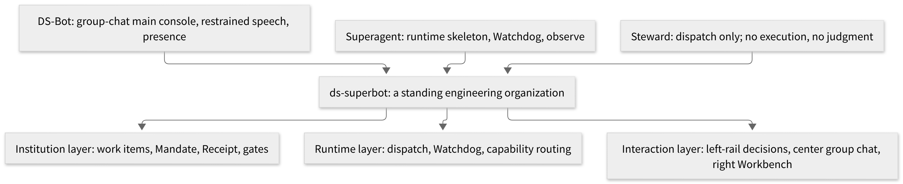
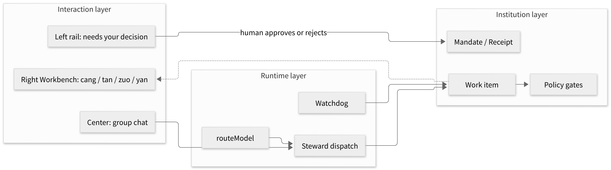
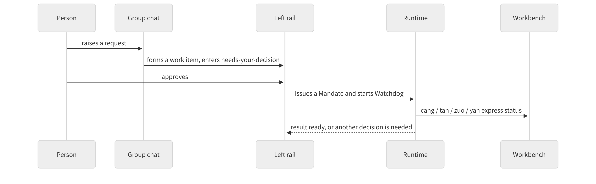
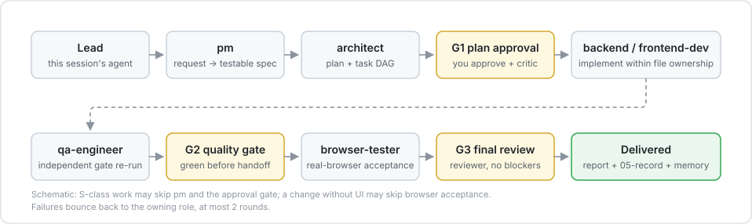

# ds-superbot

[中文](README.md) | **English**

[](https://github.com/Wjl1224734792/ds-superbot/releases)
[](LICENSE)
[](https://github.com/deepseek-ai/deepseek-harness)
[](package.json)
[](packages/dsh-plugin/tests)

ds-superbot is a **work-item console** for [DeepSeek Harness](https://github.com/deepseek-ai/deepseek-harness) (DSH). The work item is the only product object; group chat is the only human/AI console; four presence faces — cang / tan / zuo / yan — cover sense, explore, build and verify. Decisions stay with humans, operations with AI, judgment with programs.

Documents / norms / gates / evidence are the constitution, and Claim → Evidence → Receipt is the only delivery currency. The left console handles items that need your decision and work-item history; the right Workbench shows presence and evidence; process status stays out of chat. The goal is not "write the code in one shot" but to keep the project **understandable, verifiable, rollback-able and extendable** after every change.

> **Status**: `0.2.1`. Breaking changes are allowed before 1.0.0 — the DeepSeek Harness install entry is the **repository root**; run `install_bundle` against that directory. DSH itself is at `0.2.x`, so the native extension-point contract moves with the host — read the [CHANGELOG](CHANGELOG.md) before upgrading DSH.

The 0.1.0 seven-role dispatch path (`superbot_dispatch`) remains as a compatibility implementation, not the product cover.

## Architecture

Source synthesis:



Institution / runtime / interaction:



Work-item loop:



## What it fixes

Handing a request to one large model usually produces code that runs, but nobody can explain, test, review or safely change. DS Super Bot splits engineering into **accountable stages**, each with a concrete artifact and an explicit release condition:

| Stage | Who | Release condition |
|---|---|---|
| Requirements / spec | `pm` | Testable acceptance criteria, non-goals and open questions written down |
| Plan and task DAG | `architect` | Impact map, file ownership, dependency graph machine-checked (`validate-plan.mjs`) |
| Plan approval gate | You + `reviewer` (clean context) | You approve explicitly, the critic reports no blockers |
| Implementation | `backend-dev` / `frontend-dev` | Done within the task's file ownership; anything outside is sent back |
| Quality gate | `qa-engineer` | Independent re-run of `verify.mjs` is green, anti-cheat checks pass |
| Browser acceptance | `browser-tester` | Every criterion backed by readable evidence (ARIA / DOM / console / network) |
| Final review | `reviewer` | Diff review with no blocking findings |

## Features

| Capability | Shape |
|---|---|
| **7 roles** | Charters injected at dispatch time (`roles/*.md`): `pm`, `architect`, `backend-dev`, `frontend-dev`, `qa-engineer`, `browser-tester`, `reviewer`. **No Agent Preset is registered**, so roles never appear in the session-mode picker |
| **Dispatch** | `superbot_dispatch(role, description, prompt, cwd?)`: one role per call, the charter is prepended to the task prompt, the child session id comes back and the result returns automatically |
| **Model routing** | Work-item dispatch: capability × risk (and modelTiers) > that capability's Settings row > the defaults row > role `modelRouting` > the parent route. 0.1.0 `superbot_dispatch` is unchanged: project-root `modelRouting.<role>` (repository wins) > that role's Settings row > the defaults row > the parent route. Routes are validated before dispatch; an unknown model fails loudly |
| **Right Workbench** | One per session: layered workflow tree by default, free drag and zoom, graph/list toggle; nodes show role / actual model / task / state / elapsed / tokens; a native task-progress bar on top; a collapsed artifacts area at the bottom |
| **Settings model table** | "Settings → Super Bot": per-role and per-capability (Discover, Build, Verify, plus Steward / Explorer / Scout / Curator / Cartographer) provider / model / reasoning effort; empty rows use the same defaults, then inherit the parent; real validation and a source column. cang / tan / zuo / yan stay presence faces, not new role seats |
| **Shared task board** | `superbot_board`: mirrors the plan onto the Agent Teams board as gates plus work items, idempotently |
| **Documentation pipeline** | Four entry points (`docs-new` / `docs-takeover` / `docs-feature` / `docs-review`) plus the rulebook (`docs-rules`) and a governance layer (`docs-governance`) |
| **Documentation readiness gate** | With `docTier=3`, `backend-dev` / `frontend-dev` cannot be dispatched until `docs-ready.mjs` has issued a valid receipt |
| **Gate scripts** | Plan validation, independent verification, baseline guard, run state machine, maintenance scan, documentation pipeline — plain Node, zero dependencies |
| **Skills** | 13 native skills registered on `ctx.skills` |

## Requirements

- [DeepSeek Harness](https://github.com/deepseek-ai/deepseek-harness) `>=0.2.1-rc.2 <0.4.0-0` (Desktop or Web)
- Node.js `>=20`
- A DSH profile (bundles are installed per profile and apply to every session)

## Install

This repository is a monorepo. The DeepSeek Harness install entry is the **repository root** (package name `ds-superbot`). No build step, no `npm install`.

```bash
git clone https://github.com/Wjl1224734792/ds-superbot.git
```

Then point the DSH plugin manager at the repository root:

```text
plugin_manager(action="install_bundle", target="<absolute path of the clone>")
```

Restart DSH afterwards (Host code loads at startup) and open a **new session** — the skill catalog is a per-session snapshot, so older sessions may still show the previous copy.

- **Upgrade**: `git pull`, then `install_bundle` the same directory again and restart.
- **Uninstall**: remove the `ds-superbot` bundle in the plugin manager.
- **Coexistence**: skill names are global. If another plugin already registered a skill with the same name, this plugin skips that skill and logs a warning — the plugin still loads, and its tools and panel are unaffected. Tool names are prefixed with `superbot_`.

## Quick start

1. Install as above, restart DSH, open a new session.
2. Ask in natural language:

   ```text
   Use Super Bot to add a total-amount script under tmp/demo, with a unit test, and get it green
   ```

   The lead loads the `superbot` skill: classify (S/M/L) → clarify → task DAG + file ownership → dispatch → QA → browser acceptance → review → report.

3. To change a subagent's model, write `modelRouting` in the project-root `superbot.config.json` (or just say "configure the subagent model"). The next dispatch uses it; no restart needed.

## Entry points

| You want | Say |
|---|---|
| Feature delivery | "Use Super Bot to build <request>" → six phases + plan approval gate |
| Do it yourself (inline) | "Do it yourself / don't dispatch" → S / B3 / maintenance only; M needs an explicit request; L and B0/B1/B2 are refused |
| Bug fix | "Fix this bug / this feature broke" → B0–B3 triage |
| Plan only | "Plan only, no code yet" → stop at the approval gate |
| Maintenance sweep | "Run a maintenance sweep" → eight scan classes + scored backlog + small fixes |
| Take over a repo | "Take over this repository, inventory first" → T1 project memory + first health scan |
| New-project docs | "New project / initialise the seven-phase docs" → `docs-new` |
| Existing-repo docs | "Take over this repo / add docs to an existing project" → `docs-takeover` |
| One feature's docs | "Write docs for this feature / which docs does this change touch" → `docs-feature` |
| Review the docs | "Review the docs / are we ready to start" → `docs-review` |
| Rules and templates | "How should a PRD/FRD/contract be written" → `docs-rules` (rulebook, not an entry point) |
| Documentation governance | "Docs are too long / reviews pile up" → `docs-governance` |
| Change a model / effort | "Configure the subagent model" → `agent-settings` |
| Not sure which entry | Load `using-superbot` to route |

## Roles

| Role | `role` | Responsibility | Artifact |
|---|---|---|---|
| Requirements analyst | `pm` | Vague request → testable spec | `02-spec.md` |
| Architect | `architect` | Spec → impact, plan, task DAG | `02-impact.md` / `03-plan.md` / `03-plan.json` |
| Backend engineer | `backend-dev` | Test-first implementation within ownership | Implementation report |
| Frontend engineer | `frontend-dev` | UI implementation + browser acceptance script | Implementation report |
| QA engineer | `qa-engineer` | Independent gate re-run, extra tests, anti-cheat checks | QA report |
| Browser tester | `browser-tester` | Black-box acceptance in a real browser with evidence | Verdicts + defect list |
| Code reviewer | `reviewer` | Final diff review; Plan Critic mode | Review report (three-level findings) |

**Roles are not modes.** A DSH preset is a user-selectable session mode; shipping the roles as presets would put writable specialist modes into the picker and let a user bypass the plan gate, QA and review. So the plugin registers no Agent Preset: `superbot_dispatch` starts each child on DSH's built-in `standard` composition and prepends the role charter to the task prompt.

## Model routing

Two paths, neither rewrites the other.

0.1.0 `superbot_dispatch` (role dispatch, original order):

```text
1. modelRouting.<role> in the project-root superbot.config.json   ← versioned with the code
2. that role's provider / model / effort in Settings → Super Bot
3. the defaults row in Settings → Super Bot
4. the parent agent's current route
```

Work-item dispatch (`routeModel` / `dispatchWorkItem`):

```text
1. explicit capability × risk routes (and modelTiers light / strong)
2. that capability's provider / model / effort in Settings → Super Bot
3. the defaults row in Settings → Super Bot
4. project-root modelRouting.<role> (when the dispatch carries a role)
5. the parent agent's current route
```

```json
{
  "modelRouting": {
    "reviewer": { "model": "provider/strong-model", "effort": "high" },
    "qa-engineer": { "model": "provider/fast-model" }
  }
}
```

- `superbot_dispatch` walks up from the dispatch `cwd` to the project root; **the next dispatch uses the new route** (no restart).
- Routes are validated through the host's `llm.resolveModelInfo`: an unknown model or unsupported effort fails loudly instead of silently degrading.
- A malformed entry (e.g. `model` without a `provider/` prefix) counts as "not configured" and falls back to the parent route.
- Structure check: `node <plugin>/scripts/validate-config.mjs <root>/superbot.config.json`.

## Right Workbench

The panel lives in the session's **right sidebar**, which DSH stores per session — **each session gets its own panel**. Three ways to open it:

1. the always-visible **Workbench** button in the session header (`conversation.session.header.utilities`), plus the mini entry in the header corner that stays visible even with no work items;
2. the "Workbench" entry on the **right-sidebar guide** page;
3. **automatically** on the session's first Super Bot dispatch (once; closing it keeps it closed). A new session can also open the Workbench from the header entry without waiting for a dispatch.



**The panel answers exactly one question: which agent, with which model, doing what, and how far along.** Top to bottom:

1. **Task progress bar (native tasks)**: `done/total` plus one segment per task (done green / running pulse / pending grey / blocked orange), counts, and the source (Agent Teams board or session task list). **Counts only, never task names**.
2. **Workflow canvas (layered tree by default, free drag and zoom)**: `Lead · this session` at the top left as the root, a trunk through spec → architecture → implementation → quality → acceptance → review hubs with that phase's cards branching to the right. The toolbar tidies the canvas into radial / fishbone / tree layouts. Each node shows role / **actual model** (`model @ effort`, "model pending" until a request has run — never invented) / task / state / elapsed / tokens; click a node to open that child session, click `⌄` to expand details in place.
3. **Artifacts (collapsed by default)**: `run.json`, `03-plan.json`, `reports/`, `evidence/` under `tmp/superbot/<run>/`; click a row to open the file in the sidebar.

Panel data comes from native live projections — no task-file polling, no copied task list:

| What the panel shows | Native source |
|---|---|
| Subagent list / role | `subagentCatalog` projection |
| Running / waiting for input | session UI state (`running` / `pendingInteraction`) |
| Actual model | `modelSelection` projection |
| Tokens | `tokenUsage` projection |
| Elapsed / normal completion | `subagentTiming` projection |
| Turns / steps | `sessionStats` projection |
| Task progress | `agentTeam` projection, else `todos` |
| Artifacts / run dirs | workspace-files Remote (15s poll) |

Preferences (filter / canvas positions / zoom) live in browser `localStorage` under `ds-superbot.panel.*`, per session; keys written by earlier builds are migrated on first read.

## Shared task board (Agent Teams)

With the "agent teams" host bundle enabled, the shared task board is the **authoritative source** of task state. `superbot_board` mirrors the plan onto it idempotently (matched through the `superbot:plan=` / `superbot:gate=` markers in each description):

| Board task | Source | Purpose |
|---|---|---|
| `G1 · plan approval` | gate | Work items cannot be claimed until it completes (native dependency gate) |
| `T<id> · <role> · <title>` | plan tasks | Work item: goal / done-when / file ownership / report destination |
| `G2 · QA gate` / `G3 · final review` | gates | Depend on all work items / on QA |

- Assignment: `superbot_board(action="brief", ...)` returns a self-contained brief → `spawn_teammate` → `team_task_update(action="reassign", ...)`.
- Without the team bundle there is no `agentTeams` service: `superbot_board` fails loudly and the flow falls back to `superbot_dispatch` + `run.json`.

## Documentation pipeline and the hard gate

Documentation splits by scenario into three entry points plus a review entry, with rules and templates kept separately:

| Scenario | Entry | Covers |
|---|---|---|
| New project / build the baseline | `docs-new` | 01-requirement → 02-architecture → 03-contract (+05-pages) → 06-test baseline → 07-governance → closure → review → receipt |
| Take over an existing repo | `docs-takeover` | `take-over.mjs` inventory → placement mapping → baseline record → fill the gaps |
| One feature / requirement change | `docs-feature` | Impact scan → touch only the affected phases (`na` + reason elsewhere) → change-link table in the same batch |
| Review / are we ready | `docs-review` | Fresh read-only reviewer → review record + machine-readable verdict → `approve` |

**The gate is not a prompt.** With `docTier: 3` in `superbot.config.json`, `superbot_dispatch` checks the receipt and document hashes in `.superbot/docs-state.json` before dispatching `backend-dev` / `frontend-dev` and refuses otherwise (other roles stay dispatchable so someone can fix docs and review). Receipts are issued only by the script:

```bash
node <plugin>/scripts/docs-ready.mjs <root> init --scope new|takeover|feature --write  # declare the scope
node <plugin>/scripts/docs-ready.mjs <root> check [--plan <03-plan.json>] [--strict]   # machine-check closure
node <plugin>/scripts/docs-ready.mjs <root> approve --review <review-record>           # issue the receipt
node <plugin>/scripts/docs-ready.mjs <root> status                                     # current state (incl. stale)
```

Criteria and error codes are in `docs-ready --help` and the `docs-rules` skill. Editing any normative document (PRD / FRD / architecture / contract / page / test plan) invalidates the receipt; bookkeeping documents are excluded from the hash.

**Rollback**: set `docTier` back to 1/2 and the whole gate turns off — no code change.

## Configuration reference

`<project-root>/superbot.config.json` (every field optional; validate with `scripts/validate-config.mjs`):

```json
{
  "docTier": 3,
  "modelRouting": {
    "reviewer": { "model": "provider/strong-model", "effort": "high" },
    "qa-engineer": { "model": "provider/fast-model" }
  },
  "execution": { "mode": "subagent" }
}
```

| Field | Meaning |
|---|---|
| `docTier` | `0/1/2` = T0/T1 only; `3` = seven-phase documentation tree + the development gate |
| `modelRouting.<role>` | Per-role provider/model/effort, highest priority |
| `execution.mode` | `subagent` (default) or `inline` (the lead does the work itself, with a reduced scope) |

## Repository layout

```text
.
├── package.json                 # public ds-superbot plugin (DSH install entry) plus monorepo scripts
├── AGENTS.md                    # monorepo conventions and red lines
├── docs/                        # architecture, development, and product contracts
│   ├── ARCHITECTURE.md
│   ├── DEVELOPMENT.md
│   └── product/                 # CONTRACT.md / INTERACTION.md
└── packages/
    ├── dsh-plugin/              # plugin implementation (internal name @ds-superbot/plugin)
    │   ├── index.js / client.js
    │   ├── roles/ / skills/
    │   ├── scripts/             # shims that forward to constitution
    │   ├── assets/residents/    # formal original faces for 仓/探/作/验
    │   └── tests/
    ├── constitution/            # @ds-superbot/constitution: ledger, policy, receipts, gate SSOT
    ├── runtime/                 # @ds-superbot/runtime: Steward / Compiler / routeModel / Event Bus / Watchdog / observe
    └── im/                      # @ds-superbot/im: three cards, speak rules, presenceOf
```

## Development and tests

```bash
npm run check    # node --check over the plugin and new entry files
npm test         # node:test across packages
```

Tests drive `apply()` with a fake `ctx` and run the `client.js` factory through a fake module loader, plus Constitution CLI fixtures in temporary directories. You do not need to start DSH, and tests must not touch the network:

- `packages/dsh-plugin/tests/dsh-plugin.test.mjs`: tool registration and argument checks, charter injection, routing priority, the documentation hard gate, command / skill registration, panel rendering and board interaction, the Settings table, style scoping
- `packages/dsh-plugin/tests/docs-ready.test.mjs`: end-to-end docs-ready behaviour and exit codes (via the plugin shim)
- `packages/dsh-plugin/tests/docs-governance.test.mjs`: documentation governance gates and snapshots
- `packages/constitution/tests/`: work-item ledger, Mandate, Policy, Receipt, cards, and CLI
- `packages/runtime/tests/`, `packages/im/tests/`: Event Bus, subscribe, Watchdog, would-accept, auto grayscale, Compiler, routeModel, Steward candidates, `presenceOf`

Details are in [docs/DEVELOPMENT.md](docs/DEVELOPMENT.md). Architecture is in [docs/ARCHITECTURE.md](docs/ARCHITECTURE.md). Contracts are in [docs/product/CONTRACT.md](docs/product/CONTRACT.md). Interaction is in [docs/product/INTERACTION.md](docs/product/INTERACTION.md).

## Troubleshooting

- **Nothing changed after installing**: Host code loads only after a DSH restart; the skill catalog is a per-session snapshot, so open a **new session**.
- **`/superbot` echoes the roster**: the roster command is `/superbot-roster`; `/superbot` is the slash gesture for the `superbot` skill (followed by a space or Enter).
- **A skill is missing**: if another plugin registered the same skill name first, this plugin skips it and logs a warning; remove or rename the conflicting plugin.
- **Model routing does not apply**: a malformed `modelRouting.<role>` counts as "not configured"; run `validate-config.mjs` to check the structure.
- **`superbot_board` says "Agent Teams not enabled"**: that is an optional capability; keep using `superbot_dispatch` + `run.json`.

## Contributing

Issues and pull requests are welcome. Read [AGENTS.md](AGENTS.md) first — it documents the directory layout, the hard constraints and the gates every change must pass. Use `<type>(<scope>): <summary>` for commit messages, and update both language versions when user-facing copy changes.

There is **no CI**: the gates are local — `node --check` plus `node --test tests/` must be green.

## License

[MIT](LICENSE) © 2026 Lin

## More

- Changelog: [CHANGELOG.md](CHANGELOG.md)
- Architecture and extension points: [docs/ARCHITECTURE.md](docs/ARCHITECTURE.md)
- Development and release: [docs/DEVELOPMENT.md](docs/DEVELOPMENT.md)
- 中文: [README.md](README.md)
