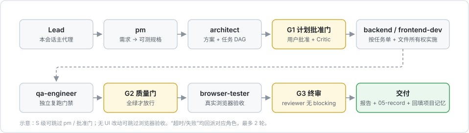

# DS Super Bot

**中文** | [English](README.en.md)

[](https://github.com/Wjl1224734792/ds-superbot/releases)
[](LICENSE)
[](https://github.com/deepseek-ai/deepseek-harness)
[](package.json)
[](packages/dsh-plugin/tests)

DS Super Bot 是给 [DeepSeek Harness](https://github.com/deepseek-ai/deepseek-harness)（DSH）用的**多角色研发团队插件**：主对话代理担任 **Tech Lead**，把需求拆成任务 DAG，按「依赖 + 文件所有权」把任务派给对应角色的子代理，走完**计划批准门 → QA → 浏览器验收 → 终审**才交付。

目标不是「一次把代码写完」，而是让项目在每次变更后仍然**可理解、可验证、可回滚、可继续演进**。

> **状态**：`0.2.0`（P0 monorepo）。1.0.0 之前允许破坏性变更——安装路径改为 `packages/dsh-plugin`。DSH 处于 `0.2.x` 阶段，插件的原生扩展点契约随宿主版本演进——升级 DSH 前请先看 [CHANGELOG](CHANGELOG.md)。


仓库本身是一支**常驻的工程组织**：群聊是唯一人机控制台，文档 / 规范 / 门禁 / 证据是宪法，工作项是唯一产品对象，Claim → Evidence → Receipt 是唯一交付货币。决定在人、操作在 AI、判定在程序。P0 先交付 monorepo 骨架、契约校验、Constitution Service、兼容 shim，以及 `presenceOf` 与占位头像；7 角色派单路径保留。

## 它解决什么问题

把需求一次性丢给一个大模型，常见结果是：代码能跑但没人说得清为什么这么写、改一次就散、测试补不上、评审无从下手。DS Super Bot 把「研发」拆成**可追责的工序**，每一步都有明确的产出与放行条件：

| 工序 | 谁做 | 放行条件 |
|---|---|---|
| 需求澄清 / 规格 | `pm` | 可测的验收标准（AC），非目标与开放问题写清 |
| 方案与任务 DAG | `architect` | 影响面、文件所有权、依赖关系可机检（`validate-plan.mjs`） |
| 计划批准门 | 用户 + `reviewer`（干净上下文） | 用户明确批准，Critic 无 blocking |
| 实施 | `backend-dev` / `frontend-dev` | 任务单范围内完成，越界即回派 |
| 质量门 | `qa-engineer` | 独立复跑 `verify.mjs` 全绿，反作弊检查通过 |
| 浏览器验收 | `browser-tester` | 逐条 AC 有可读证据（ARIA / DOM / console / network） |
| 终审 | `reviewer` | diff 无 blocking 意见 |

## 特性一览

| 能力 | 形态 |
|---|---|
| **7 个角色** | 派单时注入的章程（`roles/*.md`）：`pm`、`architect`、`backend-dev`、`frontend-dev`、`qa-engineer`、`browser-tester`、`reviewer`。**不注册 Agent Preset**，所以角色不会出现在模式选择器里 |
| **派发** | `superbot_dispatch(role, description, prompt, cwd?)`：一个角色一次调用，章程自动拼进派单正文，返回子会话 id，结果自动回传 |
| **三层模型路由** | 项目根 `superbot.config.json` 的 `modelRouting.<role>`（仓库优先） > 设置页该角色 > 设置页默认 > 继承主代理；派发前校验模型与思考强度，未知模型直接报错 |
| **右侧栏团队面板** | 每会话一份：默认分层工作流树、自由拖拽缩放、图 / 列表切换；节点显示角色 / 实际模型 / 任务 / 状态 / 耗时 / tokens；顶部原生任务进度条；底部可折叠产物区 |
| **设置页模型表格** | 「设置 → Super Bot」逐角色 provider / model / 思考强度，带真实校验与来源列 |
| **共享任务板** | `superbot_board`：把计划幂等同步成 Agent Teams 板上的门禁 + 工作单 |
| **文档流水线** | 四个入口（`docs-new` / `docs-takeover` / `docs-feature` / `docs-review`）+ 规范总库（`docs-rules`）+ 治理增量层（`docs-governance`） |
| **文档就绪硬门** | `docTier=3` 时，没有 `docs-ready.mjs` 签发的收据，`backend-dev` / `frontend-dev` 派不出去 |
| **门禁脚本** | 计划校验、独立验证、基线守卫、运行状态机、维护扫描、文档流水线——纯 Node、零依赖 |
| **技能** | 13 个原生技能，随插件注册到 `ctx.skills` |

## 前置条件

- [DeepSeek Harness](https://github.com/deepseek-ai/deepseek-harness) `>=0.2.1-rc.2 <0.4.0-0`（Desktop 或 Web 均可）
- Node.js `>=20`
- 一个可用的 DSH profile（插件装在 profile 里，对所有会话生效）

## 安装

本仓库是 monorepo。DeepSeek Harness 的安装入口是 **`packages/dsh-plugin`**（该包的 `name` 仍是 `ds-superbot`，`dsh.bundle` / `dsh.client` 保持不变）。不需要构建，不需要 `npm install`。

```bash
git clone https://github.com/Wjl1224734792/ds-superbot.git
```

然后在 DSH 里用插件管理器安装插件包目录：

```text
plugin_manager(action="install_bundle", target="<克隆下来的绝对路径>/packages/dsh-plugin")
```

装完 **重启 DSH**（Host 代码只在启动时加载），再开 **新会话**——技能目录是会话级快照，旧会话可能仍显示上一版文案。

- **升级**：`git pull` 后对同一目录重新 `install_bundle`，再重启 DSH。开发期可用插件管理器的禁用 / 启用做热重载。
- **卸载**：插件管理器里移除 `ds-superbot` 这个 bundle。
- **与其它插件共存**：技能名是全局唯一的。若同名的技能已被别的插件占用，本插件会跳过该技能并打一条 warning，**不影响插件加载**与它独有的工具、面板。工具名前缀是 `superbot_`，不会和别的插件冲突。

## 快速开始

1. 装好并重启 DSH，开一个新会话。
2. 直接用自然语言提需求：

   ```text
   用 Super Bot 给 tmp/demo 写一个金额汇总脚本，带单测并跑绿
   ```

   主代理会加载 `superbot` 技能：受理定级（S/M/L）→ 需求澄清 → 任务 DAG + 文件所有权 → 派子代理 → QA → 浏览器验收 → 终审 → 汇报。

3. 需要换子代理模型：在项目根写 `superbot.config.json` 的 `modelRouting`（或直接说「配置子代理模型」），下一次派发立即生效，不需要重启。

## 入口一览

| 想做什么 | 怎么说 |
|---|---|
| 功能交付 | 「用 Super Bot 做 <需求>」→ 六阶段 + 计划批准门 |
| 直接执行（inline） | 「你直接做 / 别派子代理」→ 限 S 级 / B3 / 维护小修；M 需显式要求；L 与 B0/B1/B2 禁止 |
| Bug 修复 | 「修这个 Bug / 这个功能坏了」→ B0–B3 分流 |
| 只出计划 | 「只出方案，先别写代码」→ 到批准门停止 |
| 维护循环 | 「做一次维护扫描」→ 八类扫描 + 评分 backlog + 小修 |
| 接手存量 | 「接手这个仓库，先盘点再动手」→ T1 项目记忆 + 首轮健康扫描 |
| 新建项目文档 | 「新建项目 / 初始化七阶段文档」→ `docs-new` |
| 接手存量文档 | 「接手这个仓库 / 存量项目补文档」→ `docs-takeover` |
| 单个功能文档 | 「给这个功能写文档 / 这个需求要动哪些文档」→ `docs-feature` |
| 审查文档 | 「审查文档 / 文档齐了吗 / 能不能开工」→ `docs-review` |
| 文档规范与模板 | 「PRD/FRD/契约怎么写」→ `docs-rules`（总库，不是入口） |
| 文档治理 | 「文档太长了 / 评审堆在 07 / 需求文档要留版本」→ `docs-governance` |
| 改模型 / 档位 | 「配置子代理模型」→ `agent-settings` |
| 不知道用哪个入口 | 加载 `using-superbot` 做路由 |

## 角色名册

| 角色 | `role` | 职责 | 产出 |
|---|---|---|---|
| 需求分析师 | `pm` | 模糊需求 → 可测规格 | `02-spec.md` |
| 架构师 | `architect` | 规格 → 影响面 + 方案 + 任务 DAG | `02-impact.md` / `03-plan.md` / `03-plan.json` |
| 后端工程师 | `backend-dev` | 按任务单 TDD 实施 | 实施报告 |
| 前端工程师 | `frontend-dev` | UI 实施 + 浏览器验收脚本 | 实施报告 |
| 测试工程师 | `qa-engineer` | 独立复跑门禁、补测试、反作弊检查 | QA 报告 |
| 浏览器验收员 | `browser-tester` | 真实浏览器黑盒验收 + 证据文件 | 逐条判定 + 缺陷清单 |
| 代码评审员 | `reviewer` | 终审 diff；Plan Critic 模式审计划 | 终审报告（三级意见） |

**角色不是模式**：本插件不注册任何 Agent Preset。DSH 里 preset 就是用户可选的会话模式，把角色做成 preset 等于把「后端工程师」这类可写的专员模式摆进选择器——用户切过去随手改代码，就绕开了计划门、QA 与终审，正好毁掉这套流程的价值。因此 `superbot_dispatch` 让子代理跑在 DSH 内置的 `standard` 组合上，把角色章程拼在派单正文前面。

## 模型路由

优先级（唯一事实链）：

```text
1. 项目根 superbot.config.json 的 modelRouting.<role>   ← 仓库优先，跟代码进同一个 diff
2. 设置 → Super Bot 里该角色的 provider / model / effort
3. 设置 → Super Bot 的默认行
4. 继承主代理当前路由
```

```json
{
  "modelRouting": {
    "reviewer": { "model": "provider/strong-model", "effort": "high" },
    "qa-engineer": { "model": "provider/fast-model" }
  }
}
```

- `superbot_dispatch` 按派单的 `cwd` 上溯找项目根并读取，**下一次派发即生效**（不需要重启）。
- 派发前用宿主的 `llm.resolveModelInfo` 校验：模型不存在或档位不支持会直接报错，不会静默降级。
- 格式错误（如 `model` 少了 `provider/` 前缀）按「没有配置」处理，落到继承主代理。
- 结构机检：`node <插件目录>/scripts/validate-config.mjs <项目根>/superbot.config.json`。

## 右侧栏团队面板

面板在会话的**右侧栏**里。DSH 的右侧栏按会话保存布局，所以**每个会话各开各的面板**。三种打开方式：

1. 会话标题栏的 **Super Bot 图标**（`conversation.session.header.utilities`）；
2. **右侧栏引导页**里的「Super Bot 团队」入口；
3. **自动打开**：该会话第一次出现 Super Bot 派发时自动打开一次（用户手动关掉后不再抢回）。



**面板只回答一件事：哪个智能体、用什么模型、在做什么、到哪了。** 自上而下三块：

1. **任务进度条（原生任务）**：`完成/总数` + 每任务一段（完成绿 / 进行中呼吸 / 待开始灰 / 被阻塞橙）+ 计数 + 来源（Agent Teams 任务板 / 会话任务列表）。**只给计数，不列任务名**。
2. **工作流画板（默认分层树，自由拖拽 + 缩放）**：`Lead · 本会话` 在左上作根，主干串起需求 → 架构 → 实施 → 质量 → 验收 → 评审各枢纽，每个枢纽向右分叉出该阶段的卡片。工具栏可一键整理为辐射 / 鱼骨 / 树状。节点显示角色 / **实际模型**（`model @ 思考强度`，没发过请求时写「模型待定」，不编造）/ 任务 / 状态 / 用时 / tokens；点节点在右侧栏打开子会话，点 `⌄` 原地展开详情。
3. **产物区（默认折叠）**：`tmp/superbot/<run>/` 下的 `run.json`、`03-plan.json`、`reports/`、`evidence/`，点一行在右侧栏打开文件。

面板数据全部来自 DSH 原生实时投影，不轮询任务文件、不复制任务列表：

| 面板里看到的 | 来源 |
|---|---|
| 子代理清单 / 角色 | `subagentCatalog` 投影 |
| 运行中 / 等待输入 | 会话 UI 状态（`running` / `pendingInteraction`） |
| 实际模型 | `modelSelection` 投影 |
| tokens | `tokenUsage` 投影 |
| 用时 / 是否正常收尾 | `subagentTiming` 投影 |
| 轮次 / 步骤 | `sessionStats` 投影 |
| 任务进度 | `agentTeam` 投影，没有则 `todos` |
| 产物 / 运行目录 | workspace-files Remote（15s 轮询） |

偏好（过滤 / 画布位置 / 缩放）保存在浏览器本地 `ds-superbot.panel.*`，按会话区分；早期版本留下的旧键会在首次读取时自动迁移。

## 共享任务板（Agent Teams）

宿主启用「智能体团队」后，共享任务板是任务状态的**权威来源**，`superbot_board` 把计划幂等同步上去（按描述里的 `superbot:plan=` / `superbot:gate=` 标记匹配）：

| 板上任务 | 来源 | 作用 |
|---|---|---|
| `G1 · 计划批准` | 门禁 | 未完成时所有工作单都 claim 不上（原生依赖闸门） |
| `T<id> · <role> · <标题>` | 计划的 tasks | 工作单：目标 / 完成标准 / 文件所有权 / 报告落点 |
| `G2 · QA 门禁` / `G3 · 终审` | 门禁 | 依赖全部工作单 / 依赖 QA |

- 派活：`superbot_board(action="brief", ...)` 取自包含任务书 → `spawn_teammate` → `team_task_update(action="reassign", ...)`。
- 没启用团队时没有 `agentTeams` 服务，`superbot_board` 直接报错，回到 `superbot_dispatch` + `run.json` 单人模式。

## 文档流水线与开发硬门

文档按场景分成三个入口 + 一个审查入口，规范与模板单独成库：

| 场景 | 入口 | 管到哪 |
|---|---|---|
| 新建项目 / 从零搭基线 | `docs-new` | 01-需求 → 02-架构 → 03-契约（+05-页面）→ 06-测试基线 → 07-治理件 → 闭环 → 审查 → 收据 |
| 接手存量仓库 | `docs-takeover` | `take-over.mjs` 盘点 → 落位映射 → 记基线 → 按缺口补齐 |
| 单个功能 / 需求变更 | `docs-feature` | 影响面扫描 → 只改受影响阶段（其余 `na` + 理由）→ 联动表同批落档 |
| 审查 / 能不能开工 | `docs-review` | reviewer 全新实例只读评审 → 评审记录 + 机读结论 → `approve` |

**硬门不是提示词**：`superbot.config.json` 配了 `docTier: 3` 后，`superbot_dispatch` 在派 `backend-dev` / `frontend-dev` 前会校验 `.superbot/docs-state.json` 的收据与文档哈希，未通过直接拒绝（其它角色不受限，留出补文档与评审的余地）。收据只由脚本签发：

```bash
node <插件>/scripts/docs-ready.mjs <root> init --scope new|takeover|feature --write  # 声明范围
node <插件>/scripts/docs-ready.mjs <root> check [--plan <03-plan.json>] [--strict]   # 闭环机检
node <插件>/scripts/docs-ready.mjs <root> approve --review <评审记录>                 # 签发收据
node <插件>/scripts/docs-ready.mjs <root> status                                     # 现状（含 stale）
```

判据与错误码都在 `docs-ready --help` 与 `docs-rules` 技能里。口径类文档（PRD / FRD / 架构 / 契约 / 页面 / 测试方案）改一次收据即失效；日常销项类文档已从哈希里排除。

**回滚**：把 `docTier` 改回 1/2 即关闭整套门禁，不需要改代码。

## 配置参考

`<项目根>/superbot.config.json`（全部字段可选；结构可用 `scripts/validate-config.mjs` 机检）：

```json
{
  "docTier": 3,
  "modelRouting": {
    "reviewer": { "model": "provider/strong-model", "effort": "high" },
    "qa-engineer": { "model": "provider/fast-model" }
  },
  "execution": { "mode": "subagent" }
}
```

| 字段 | 作用 |
|---|---|
| `docTier` | `0/1/2` = 只维护 T0/T1；`3` = 七阶段文档树 + 开发硬门 |
| `modelRouting.<role>` | 该角色的 provider/model/effort，优先级最高 |
| `execution.mode` | `subagent`（默认）或 `inline`（主代理自己动手，范围受限） |

## 仓库结构

```text
.
├── package.json                 # 私有 workspace：test / check 调各包
├── AGENTS.md                    # monorepo 约定与红线
├── docs/                        # 架构、开发与产品契约
│   ├── ARCHITECTURE.md
│   ├── DEVELOPMENT.md
│   └── product/                 # CONTRACT.md / INTERACTION.md
└── packages/
    ├── dsh-plugin/              # DSH 安装入口（name: ds-superbot）
    │   ├── index.js / client.js
    │   ├── roles/ / skills/
    │   ├── scripts/             # 转发到 constitution 的 shim
    │   ├── assets/residents/    # 仓/探/作/验占位头像
    │   └── tests/
    ├── constitution/            # @ds-superbot/constitution：账本、Policy、Receipt、门禁 SSOT
    ├── runtime/                 # @ds-superbot/runtime：P0 接口；bus/watchdog/subscribe 为占位
    └── im/                      # @ds-superbot/im：三种卡、发言规则、presenceOf
```

## 开发与测试

```bash
npm run check    # node --check 覆盖插件与新入口
npm test         # 各包 node:test
```

测试用假 `ctx` 驱动 `apply()`、用假模块加载器执行 `client.js` 工厂，并在临时目录跑 Constitution CLI，因此不需要启动 DSH，也不访问网络：

- `packages/dsh-plugin/tests/dsh-plugin.test.mjs`：工具注册与参数校验、章程注入、路由优先级、文档硬门、命令 / 技能注册、面板渲染与画板交互、设置页表格、样式作用域
- `packages/dsh-plugin/tests/docs-ready.test.mjs`：文档就绪脚本（经 shim）的端到端行为与错误码
- `packages/dsh-plugin/tests/docs-governance.test.mjs`：文档治理门禁与快照行为
- `packages/constitution/tests/`：工作项账本、Mandate、Policy、Receipt、卡片与 CLI
- `packages/runtime/tests/`、`packages/im/tests/`：导出形状、`NOT_IMPLEMENTED`、`presenceOf`

细节见 [docs/DEVELOPMENT.md](docs/DEVELOPMENT.md)，架构见 [docs/ARCHITECTURE.md](docs/ARCHITECTURE.md)，契约见 [docs/product/CONTRACT.md](docs/product/CONTRACT.md)，交互见 [docs/product/INTERACTION.md](docs/product/INTERACTION.md)。

## 排障

- **装完没变化**：Host 代码在 DSH 重启后才加载；技能目录是会话级快照，开**新会话**。
- **`/superbot` 回显的是名册**：名册命令是 `/superbot-roster`；`/superbot` 是触发 `superbot` 技能的斜杠手势（后面接空格或直接回车）。
- **技能里少了一个**：如果同名技能被其它插件先占用，本插件会跳过并打 warning；把它卸掉或换掉冲突方即可。
- **模型路由不生效**：`modelRouting.<role>` 格式错误按「没配置」处理；跑 `validate-config.mjs` 校验结构。
- **`superbot_board` 报「Agent Teams 未启用」**：这是可选能力；单人模式继续用 `superbot_dispatch` + `run.json`。

## 贡献

Issues 与 PR 都欢迎。动手前请读 [AGENTS.md](AGENTS.md)（仓库开发约定：目录归属、硬性约束、每次改动要跑的门禁）。提交信息用 `<type>(<scope>): <summary>`，改了面向用户的文案请中英两份一起改。

本项目**不做 CI**，门禁是本地脚本：`node --check` + `node --test tests/` 全绿才算完。

## 许可

[MIT](LICENSE) © 2026 Lin

## 更多

- 变更记录：[CHANGELOG.md](CHANGELOG.md)
- 架构与扩展点：[docs/ARCHITECTURE.md](docs/ARCHITECTURE.md)
- 开发与发布：[docs/DEVELOPMENT.md](docs/DEVELOPMENT.md)
- English: [README.en.md](README.en.md)
